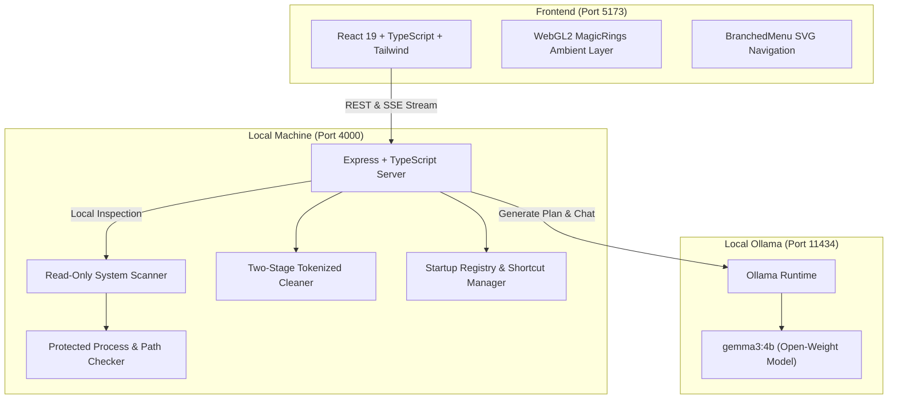

<div align="center">

# 🪶 Featherlight

### *Make your laptop light again.*

A privacy-first, local AI assistant that scans your laptop, identifies what is slowing it down, and safely cleans the junk with zero cloud dependencies.

[](LICENSE)
[](https://react.dev/)
[](https://www.typescriptlang.org/)
[](https://vitejs.dev/)
[](https://nodejs.org/)
[](https://ollama.com/)
[](#-privacy--safety-first)

[Getting Started](#-quickstart) • [Architecture](#-architecture) • [Safety Guardrails](#-safety-guardrails) • [Components](#-rich-ui--motion) • [API](#-api-reference)

</div>

---

## 💡 Why Featherlight?

Older laptops lag because background processes accumulate, startup registries get cluttered, and drive space drops below the critical 20% runway threshold. Traditional PC cleaners are often bloated, ad-supported, or upload telemetry to third-party servers.

**Featherlight fixes this through a minimal, 100% local approach:**

* 🔒 **100% Offline AI**: Uses open-weight **Gemma 3 4B** (or local Gemma variants) served on your machine via **Ollama**. Your file names, system processes, and hardware details never leave your laptop.
* 🛡️ **Ironclad Safety Guardrails**: Windows system directories, drivers, antivirus software, task manager, and your personal folders (`Documents`, `Desktop`, `Downloads`) are hard-coded as immutable and protected.
* ⚡ **Two-Stage Safe Clean**: No file is ever removed without an explicit dry-run preview and cryptographic single-use confirmation token.
* 🔄 **Reversible Startup Optimizer**: Disabling user-level startup apps automatically creates registry and folder backups that can be restored with a single click.
* 🎯 **Drive Runway Target (80%)**: Focuses on reclaiming temporary caches and thumbnail databases to bring drive storage comfortably back under the 80% capacity limit.

---

## 🏗️ Architecture



> [!NOTE]
> Featherlight requires **zero API keys** and **no cloud sign-in**. If Ollama is offline or still downloading, Featherlight automatically falls back to an instant, rule-based optimization engine so you can always scan and clean your laptop.

---

## 🛡️ Safety Guardrails

Featherlight divides all potential optimization items into strict safety tiers:

| Tier | Category | Allowed Actions | Safety Protocol |
|:---|:---|:---|:---|
| **Level 1** | Safe Temporary Junk | Clean with 1 click | Dry-run preview token required. Restricted to Windows Temp (`%TEMP%`, `C:\Windows\Temp`) and crash dumps. |
| **Level 2** | User Startup Entries | Switch off / Disable | User HKCU Run key and user Startup shortcuts only. Registry and file backups created before any toggle. |
| **Level 2** | Background App Hoggers | Close when idle | Non-protected user processes consuming >100 MB RAM. |
| **Level 3** | Personal & System Files | **Protected (Read-Only)** | `Documents`, `Downloads`, `Desktop`, system drivers, antivirus, shell, and core Windows directories can **never** be deleted. |

---

## 🎨 Minimalist Design & Motion

Featherlight strictly adheres to a high-contrast, three-color minimalist palette designed to feel like an industrial instrument:

* **Charcoal Grey (`#2A2A2A`)**: Base surface and matte background.
* **Moonlit Silver (`#C0C0C0`)**: Clean Inter typography, icons, and subtle 1px hairline borders.
* **Signal Red (`#E10600`)**: The solitary accent color (primary scan CTA, health indicator, and critical warnings).

### Integrated React Bits Components

Featherlight incorporates interactive components from [React Bits](https://reactbits.dev/):

* **[`<MagicRings />`](frontend/src/components/MagicRings.tsx)**: Multi-pass WebGL2 shader background with 3D projection, cursor parallax, spring physics, and interactive `clickBurst` ripples across the entire desktop window.
* **[`<RotatingText />`](frontend/src/components/RotatingText.tsx)**: Staggered animated typography highlighting the hero tagline (`light`, `fast`, `cool`, `clean`, `quiet`) and real-time scanning steps.
* **[`<BranchedMenu />`](frontend/src/components/BranchedMenu.tsx)**: Interactive SVG tree rail with animated branch curves and active markers for jumping directly between sections on the results dashboard.

---

## 📁 Repository Structure

```text
├── backend/               # Node.js + Express + TypeScript engine (Port 4000)
│   ├── src/
│   │   ├── config.ts      # Environment configuration (DRY_RUN simulation default)
│   │   ├── protected.ts   # Protected process and path allowlists
│   │   ├── scanner.ts     # Read-only RAM, CPU, drive, startup, and cache inspection
│   │   ├── planner.ts     # AI plan generator with strict JSON validation & fallback
│   │   ├── cleaner.ts     # Tokenized safe cleaner with dry-run support
│   │   ├── startup_manager.ts # User-level startup toggles with 1-click restore
│   │   ├── app_manager.ts # Safe process closer
│   │   └── routes/        # REST endpoints & SSE streaming routes
│   ├── package.json
│   └── README.md
│
├── frontend/              # Vite + React 19 + TypeScript web app (Port 5173)
│   ├── src/
│   │   ├── components/
│   │   │   ├── MagicRings.tsx    # WebGL2 full-desktop background shader
│   │   │   ├── RotatingText.tsx  # Staggered animated word rotator
│   │   │   ├── BranchedMenu.tsx  # SVG tree navigation sidebar
│   │   │   ├── HomeScreen.tsx    # Hero view with 1-click scan button
│   │   │   ├── ScanningScreen.tsx# Active sonar/radar inspection screen
│   │   │   ├── ResultScreen.tsx  # Health score, clean preview, and fixes
│   │   │   ├── CleanModal.tsx    # Two-step confirmation dialog
│   │   │   ├── AskPanel.tsx      # Local Gemma AI assistant with streaming
│   │   │   └── HistoryTab.tsx    # Clean history log and audit trail
│   │   ├── api.ts         # Type-safe API client
│   │   └── demoData.ts    # Labelled offline sample report
│   ├── package.json
│   └── README.md
│
├── LICENSE                # MIT License
└── README.md              # Project documentation
```

---

## ⚡ Quickstart

### Prerequisites
* [Node.js](https://nodejs.org/) (v18.0.0 or later)
* [Ollama](https://ollama.com/) (recommended for local AI plan generation)

---

### Step 1: Start Ollama (Optional but Recommended)

Download and serve the recommended lightweight Gemma model:
```bash
ollama pull gemma3:4b
ollama serve
```

> [!TIP]
> If you already have `gemma2:2b` or any other local model installed, simply set `OLLAMA_MODEL="gemma2:2b"` in `backend/.env`.

---

### Step 2: Start the Backend

In a terminal window:
```bash
cd backend
npm install
npm run dev
```
The backend server will launch on `http://localhost:4000`.

---

### Step 3: Start the Frontend

In a second terminal window:
```bash
cd frontend
npm install
npm run dev
```
The application will launch on `http://localhost:5173`. Open it in your web browser!

---

## ⚙️ Configuration (`backend/.env`)

| Variable | Default | Description |
|:---|:---|:---|
| `PORT` | `4000` | Port for the Express backend server |
| `DRY_RUN` | `true` | When `true`, safe cleaning is simulated without deleting files |
| `OLLAMA_HOST` | `http://localhost:11434` | Endpoint for the local Ollama instance |
| `OLLAMA_MODEL` | `gemma3:4b` | Model name to query for optimization plans and chat |
| `OLLAMA_TIMEOUT_MS`| `30000` | Maximum timeout in ms before falling back to fast rule engine |

---

## 🔌 API Reference

### Health & Inspection
* `GET /api/health` — Checks backend status, Ollama connectivity, and active AI model.
* `GET /api/scan` — Executes real-time read-only inspection of memory, CPU, drives, startup entries, and cleanable caches.
* `POST /api/plan` — Generates an optimization plan via local Gemma 3 (with automatic deterministic fallback).

### Cleaning & Safety
* `POST /api/clean/preview` — Returns a dry-run list of files to clean along with a single-use preview token.
* `POST /api/clean/apply` — Safely cleans the previewed files using the validated preview token.
* `GET /api/clean/history` — Retrieves the history log of past cleaning operations.

### Startup & Process Management
* `POST /api/startup/disable` — Disables a user startup item and creates a restorable backup.
* `POST /api/startup/undo` — Restores a previously disabled startup item.
* `POST /api/apps/close` — Safely closes an un-protected user background application.
* `POST /api/reveal` — Reveals a target file or folder in the native file manager (Windows Explorer).

### Local AI Assistant
* `POST /api/ask/stream` — Streams token-by-token responses from local Gemma 3 via Server-Sent Events (SSE).

---

## 📜 License

Distributed under the **MIT License**. See [`LICENSE`](LICENSE) for details.

<div align="center">
<sub>Crafted with precision for private, fast, and light computing.</sub>
</div>
